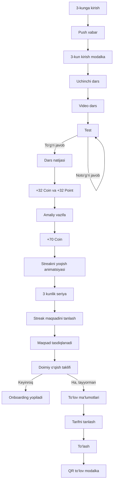

# Junior onboarding — 3-kun to‘liq jarayoni

## 1. Maqsad

3-kun onboardingining asosiy maqsadi:

1. O‘quvchini uchinchi darsga olib kirish.
2. Dars, test va amaliy vazifani yakunlatish.
3. Coin va Point orqali natijani mustahkamlash.
4. 3 kunlik streakni yoqish.
5. O‘quvchiga uzoq muddatli streak maqsadini tanlatish.
6. Kursni davom ettirish taklifini ko‘rsatish.
7. Rozilik bildirgan o‘quvchini to‘lov jarayoniga olib kirish.

## 2. Umumiy voronka

## 3. Jarayon bosqichlari

### 0-bosqich — Push xabarlarga ruxsat

O‘quvchi push xabarlarga hali javob bermagan bo‘lsa, onboarding boshlanishidan oldin ruxsat oynasi ko‘rsatiladi.

- Sarlavha: `Muhim xabarlarni o‘tkazib yubormang`
- Izoh: dars, mentor javobi va jonli dars vaqti haqida xabar berilishi tushuntiriladi.
- Asosiy tugma: `Ruxsat berish`
- Ikkinchi tugma: `Hozir emas`
- Har ikkala tanlovdan keyin 3-kun onboarding davom etadi.

### 1-bosqich — 3-kun push xabari

- Push sarlavhasi: `Uchinchi kun darsi tayyor`
- Push matni: `Bugun 3-darsni yakunlang — keyin Junior bilan keyingi qadamingizni tanlaysiz.`
- Maqsad: o‘quvchini platformaga qaytarish va bugungi darsga yo‘naltirish.

### 2-bosqich — 3-kun kirish modalka

- Progress: `1/4`
- Sarlavha: `Uchinchi kun — marraga yaqinmiz! 🚀`
- Matn: `Ikki kunlik mehnatingizni davom ettiring: bugun 3-darsni ko‘ring, test va amaliy vazifani yakunlang.`
- CTA: `Darsni boshlash`
- Fokus: bosh sahifadagi joriy kurs kartasi.
- Natija: tugma bosilganda darsning to‘liq ekrani ochiladi.

### 3-bosqich — Video dars

- Dars nomi: `Bootstrapda matnlar bilan ishlash`
- Bosqich indikatori: `1/3`
- Video davomiyligi: `13:52`
- Boshlang‘ich holat: `Davom etish` tugmasi bloklangan.
- O‘quvchi videoni bosganda ko‘rish jarayoni boshlanadi.
- Video yakunlangach:
  - vaqt `13:52` bo‘ladi;
  - `Video yakunlandi ✓` yozuvi chiqadi;
  - `Davom etish` tugmasi faollashadi.

### 4-bosqich — Test

- Bosqich indikatori: `2/3`
- Savol: `Matn pastki qatorga o‘tmasligi uchun qaysi class ishlatiladi?`
- Variantlar:
  - `text-nowrap` — to‘g‘ri javob;
  - `text-wrap` — noto‘g‘ri javob;
  - `text-break` — noto‘g‘ri javob.
- Noto‘g‘ri javobda: `Yana bir bor o‘ylab ko‘ring.`
- To‘g‘ri javobda: `To‘g‘ri! Keyingi qadamga o‘tamiz.`
- To‘g‘ri javobdan keyin natija ekraniga avtomatik o‘tiladi.

### 5-bosqich — Dars natijasi

- Status: `Dars muvaffaqiyatli yakunlandi`
- Sarlavha: `Natijangiz tayyor!`
- Matn: `Sizdek o‘quvchimiz borligidan faxrlanamiz. Ajoyib boshlanish!`
- Natijalar:
  - `✓ Video dars`
  - `✓ Test 1/1`
- CTA: `Mukofotni ochish`
- Vizual: maskot va confetti animatsiyasi.

### 6-bosqich — Dars mukofoti

- O‘quvchi sandiqni bosadi.
- Mukofot:
  - `+32 Coin`
  - `+32 Point`
- Coin va Point balanslari animatsiya bilan eski qiymatdan yangi qiymatgacha to‘ladi.
- CTA: `Davom etish`
- Natija: amaliy vazifa ekraniga o‘tiladi.

### 7-bosqich — Amaliy vazifa

- Bosqich indikatori: `3/3`
- Sarlavha: `Amaliy vazifa`
- Vazifa:
  1. Bootstrapni ulash.
  2. Har bir matnga rang berish.
  3. `fw`, `fs` yoki `fst` classlaridan foydalanish.
  4. Natijani namunadagi ko‘rinishga keltirish.
- CTA: `Vazifani topshirish`
- Demo prototipda tugma bosilganda vazifa qabul qilingan hisoblanadi.

### 8-bosqich — Amaliy vazifa mukofoti

- Sarlavha: `70 Coin mukofotingiz tayyor!`
- Matn: `Vazifangiz qabul qilindi. Sandiqni oching.`
- O‘quvchi sandiqni bosadi.
- Mukofot: `+70 Coin`
- CTA: `Davom etish`
- Natija: streak yoqish animatsiyasiga o‘tiladi.

### 9-bosqich — Streakni yoqish

- To‘liq ekranli olov animatsiyasi ochiladi.
- Ko‘rsatma: o‘quvchi yuqoriga surib, ushlab turadi.
- Olov to‘liq yoqilgach keyingi ekranga avtomatik o‘tiladi.
- Ovoz va yoritish effektlari ishlaydi.

### 10-bosqich — 3 kunlik seriya

- Asosiy raqam: `3`
- Sarlavha: `3 kunlik seriya`
- Haftalik indikatorning dastlabki 3 kuni bajarilgan holatda ko‘rsatiladi.
- Matn: `Uch kunlik odat shakllanmoqda. Har kuni ozgina qadam tashlang!`
- CTA: `Davom etish →`

### 11-bosqich — Streak maqsadini tanlash

- Sarlavha: `O‘zingga maqsad qo‘y!`
- Matn: `Necha kun ketma-ket o‘rganishni xohlaysan? Maqsadingni tanla va intil!`
- Variantlar:
  - `7 kun` — `+10 Coin`
  - `14 kun` — `+20 Coin`
  - `30 kun` — `+40 Coin`
  - `60 kun` — `+60 Coin`
- Maqsad tanlanmaguncha `Davom etish` tugmasi bloklangan.
- Tanlangan variant local storage’da saqlanadi.

### 12-bosqich — Streak maqsadini tasdiqlash

- Sarlavha dinamik: masalan, `7 kunlik maqsad — zo‘r tanlov! 🔥`
- Matn dinamik: `Kelishdik! Endi har bir dars sizni 7 kunlik marrangizga yaqinlashtiradi. Olg‘a, siz buni uddalaysiz!`
- Vizual: tanlangan maqsad, maskot va bayram animatsiyasi.
- CTA: `Davom etish`

### 13-bosqich — Kursni davom ettirish taklifi

- Sarlavha: `Biz bilan doimiy qolishga tayyormisiz?`
- Matn: `Yangi bilimlarni egallash va Junior’da o‘qishni davom ettirishga tayyormisiz?`
- Asosiy CTA: `Ha, tayyorman`
- Ikkinchi CTA: `Keyinroq`

Tarmoqlanish:

- `Keyinroq` bosilsa — onboarding yakunlanadi va bosh sahifa ochiq qoladi.
- `Ha, tayyorman` bosilsa — to‘lov ma’lumotlari sahifasi ochiladi.

### 14-bosqich — To‘lov ma’lumotlari sahifasi

Doimiy ma’lumotlar:

- Talaba ID: `1234567`
- Talaba: `Toshpo’latov Toshmuhammad`
- Kurs: `Web-dasturlash`
- Guruh: `GW30`
- Filial: `Yashnabod`
- Hisob: `№123453`

#### Holat A — qarzdor balans

- Balans: `-240 000 UZS`
- Balans qizil rangda ko‘rsatiladi.
- Tariflar:
  - `12 ta dars`
  - `24 ta dars`
  - `56 ta dars`

#### Holat B — nol balans

- Balans: `0 UZS`
- Tariflar:
  - `12 ta dars`
  - `36 ta dars`
  - `56 ta dars`

#### Tarif tanlash

- Default tanlov: `12 ta dars`
- Tanlangan tarif yashil rangda ajratiladi.
- Tarif o‘zgarganda pastdagi darslar soni va summa ham yangilanadi.
- `To’lash` tugmasi QR to‘lov modalkasini ochadi.
- Prototipda yuqori o‘ngdagi tarix belgisi orqali qarzdor va nol balans holatlarini almashtirish mumkin.

### 15-bosqich — QR orqali to‘lov

- Modal turi: pastdan chiqadigan bottom sheet.
- Sarlavha: `Boshqa qurilmadan to’lash`
- Muddat: `15 sentyabr 2026`
- QR-kod: to‘lov uchun asosiy kod.
- Izoh: `Kurslarni qayta faollashtirish uchun to’lovni amalga oshiring`
- Jami: `450 000 so’m`
- Deposit address: `0xbf88b57b5b831fd72a9f597c4a7753fff`

Amallar:

- `Nusxalash` — deposit address’ni clipboard’ga nusxalaydi.
- `Ulashish` — qurilmaning native share oynasini ochadi; Web Share ishlamasa matn nusxalanadi.
- `×` yoki qoraygan fon — QR modalkani yopadi va to‘lov ma’lumotlari sahifasiga qaytaradi.
- Orqaga tugmasi — to‘lov sahifasini yopib, platformaga qaytaradi.

## 4. Maxsus shartlar

### Kursni oldin sotib olgan o‘quvchi

Agar `JUNIOR_HAS_COURSE = true` yoki URL’da `paid=1` bo‘lsa:

- o‘quvchi uchinchi darsni ko‘radi;
- sotuv taklifi va to‘lov jarayoni ko‘rsatilmaydi.

### Onboardingni tashlab ketish

- `O‘tkazib yuborish` bosilsa joriy onboarding yopiladi.
- `Keyinroq` bosilsa sotuv taklifi yopiladi.
- Tanlangan streak maqsadi keyingi kirishlar uchun saqlanadi.

### Faollik bo‘lmasa yuboriladigan pushlar

Bu qism backend/push servisi orqali ishlashi kerak. Demo prototip faqat push preview’ni ko‘rsatadi.

Tavsiya etilgan triggerlar:

1. O‘quvchi 3-kun platformaga kirmadi — dars tayyorligi haqida eslatma.
2. Platformaga kirdi, lekin darsni boshlamadi — birinchi qadamga qaytaruvchi push.
3. Videoni ko‘rdi, lekin testni tugatmadi — testni davom ettirish push’i.
4. Darsni tugatdi, lekin amaliy vazifani topshirmadi — vazifa eslatmasi.
5. Streak maqsadini tanlamadi — maqsad tanlash eslatmasi.
6. To‘lov taklifida `Keyinroq`ni tanladi — keyingi kuni kursni davom ettirish taklifi.

## 5. Analitika eventlari

| Event | Qachon yuboriladi | Muhim parametrlar |
|---|---|---|
| `day3_onboarding_started` | 3-kun onboarding ochilganda | `user_id`, `source` |
| `day3_lesson_started` | Dars kartasi bosilganda | `course_id`, `lesson_id` |
| `day3_video_completed` | Video tugaganda | `lesson_id`, `duration` |
| `day3_test_completed` | To‘g‘ri javob berilganda | `attempts`, `lesson_id` |
| `day3_practice_submitted` | Amaliy vazifa topshirilganda | `lesson_id` |
| `day3_reward_claimed` | Coin/Point olinganda | `coin`, `point`, `reward_type` |
| `day3_streak_ignited` | Streak olovi yoqilganda | `streak_day=3` |
| `day3_streak_goal_selected` | Maqsad tanlanganda | `goal_days`, `reward_coin` |
| `day3_purchase_offer_answered` | Ha yoki Keyinroq bosilganda | `answer` |
| `day3_payment_state_viewed` | To‘lov sahifasi ochilganda | `balance_state`, `balance` |
| `day3_payment_plan_selected` | Tarif tanlanganda | `lessons`, `amount` |
| `day3_payment_qr_opened` | To‘lash bosilganda | `lessons`, `amount` |
| `day3_payment_address_copied` | Nusxalash bosilganda | `payment_method` |
| `day3_payment_shared` | Ulashish bosilganda | `payment_method` |

## 6. QA havolalar

- 3-kun to‘liq jarayoni: `?onboarding=1&qa=days&day=3`
- Qarzdor balans: `?onboarding=1&qa=days&day=3&payment_page=1&payment_state=debt`
- Nol balans: `?onboarding=1&qa=days&day=3&payment_page=1&payment_state=zero`
- QR modalka: `?onboarding=1&qa=days&day=3&payment=1`
- Sotib olingan kurs holati: `?onboarding=1&qa=days&day=3&paid=1`

## 7. Yakuniy natija

3-kun oxirida o‘quvchi:

1. Uchinchi darsini yakunlaydi.
2. Coin va Point oladi.
3. 3 kunlik streakini yoqadi.
4. Keyingi streak maqsadini tanlaydi.
5. O‘qishni davom ettirish bo‘yicha qaror qiladi.
6. Rozilik bildirsa, tarif tanlab QR orqali to‘lovga o‘tadi.
