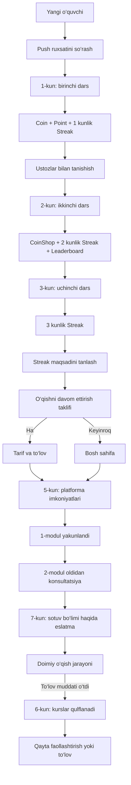

# Junior platformasi — to‘liq onboarding jarayoni

Versiya: `2026-10-28`  
Qamrov: `1, 2, 3, 5, 6 va 7-kun`  
Holat: vizual prototip va biznes-logika tavsifi

## 1. Onboarding maqsadi

Onboarding yangi o‘quvchini birinchi darsdan boshlab platformada mustaqil o‘qiy oladigan, motivatsiya tizimini tushunadigan va kerak bo‘lsa sotuv bo‘limidan yordam oladigan holatga olib keladi.

Asosiy maqsadlar:

1. O‘quvchini birinchi darsga tez olib kirish.
2. Video, test va amaliy vazifani qanday bajarishni o‘rgatish.
3. Coin, Point va Streak tizimini tushuntirish.
4. CoinShop va Leaderboard orqali motivatsiyani oshirish.
5. O‘quvchiga shaxsiy Streak maqsadini tanlatish.
6. O‘qishni davom ettirish va to‘lov jarayonini tushuntirish.
7. Sotuv bo‘limi qaysi masalalarda yordam berishini ko‘rsatish.
8. To‘lov muddati tugagan o‘quvchini platformadan butunlay chiqarib yubormasdan qayta faollashtirish.

## 2. Umumiy voronka



> `4-kun` prototipdan to‘liq olib tashlangan. Shu sabab QA menyusida 4-kun yo‘q.

## 3. Umumiy qoidalar

### 3.1. Push ruxsati

O‘quvchi push xabarlarga hali javob bermagan bo‘lsa, onboarding boshlanishidan oldin ruxsat oynasi ko‘rsatiladi.

- Sarlavha: `Muhim xabarlarni o‘tkazib yubormang`
- Mazmun: dars, mentor javobi va jonli dars vaqti haqida xabar berilishi tushuntiriladi.
- Asosiy CTA: `Ruxsat berish`
- Ikkinchi CTA: `Hozir emas`
- Har ikkala holatda onboarding davom etadi.

### 3.2. Kunlar mustaqilligi

- Har bir kun alohida ochiladi.
- Bir kunni test qilish uchun oldingi kunlarni qayta o‘tish shart emas.
- Kun holati `user_id + onboarding versiyasi + kun` bo‘yicha saqlanadi.
- Prototipdagi storage kaliti: `junior:onboarding:<user_id>:v15-sales-reminder:day-<kun>`.

### 3.3. Darsning umumiy tuzilishi

1–3-kunlarda dars jarayoni bir xil asosda ishlaydi:

1. Videoni ko‘rish.
2. Test savoliga javob berish.
3. Dars mukofotini olish.
4. Amaliy vazifani topshirish.
5. Amaliy vazifa mukofotini olish.
6. Streakni yoqish.

Standart mukofotlar:

- Dars uchun: `+32 Coin` va `+32 Point`.
- Amaliy vazifa uchun: `+70 Coin`.

## 4. 1-kun — xush kelibsiz va birinchi dars

### Maqsad

O‘quvchini darhol birinchi darsga olib kirish, dastlabki natijani berish va yordam beradigan ustozlar borligini ko‘rsatish.

### Push xabar

- Sarlavha: `Birinchi darsingiz tayyor`
- Matn: `Bugun video, qisqa test va amaliy vazifa sizni kutmoqda.`

### Bosqichlar

#### 1-bosqich — kutib olish

- Sarlavha: `Xush kelibsiz! 👋`
- Matn: Junior yordamchisi platformadagi kerakli imkoniyatlarni o‘z vaqtida ko‘rsatib borishi tushuntiriladi.
- CTA: `Birinchi darsga o‘tish`

#### 2-bosqich — birinchi darsga yo‘naltirish

- Fokus: bosh sahifadagi birinchi kurs kartasi.
- Sarlavha: `Birinchi darsingiz tayyor`
- Matn: dars yakunlangach Coin va Point berilishi aytiladi.
- CTA: `Darsni boshlash`

#### 3-bosqich — video

- O‘quvchi videoni ishga tushiradi.
- Video tugamaguncha keyingi bosqich bloklangan.
- Video tugagach `Video yakunlandi ✓` holati chiqadi.

#### 4-bosqich — test

- O‘quvchi variantlardan birini tanlaydi.
- Noto‘g‘ri javobda qayta urinish mumkin.
- To‘g‘ri javobdan keyin dars natijasi ochiladi.

#### 5-bosqich — dars mukofoti

- O‘quvchi sandiqni ochadi.
- `+32 Coin` va `+32 Point` balansga animatsiya bilan qo‘shiladi.

#### 6-bosqich — amaliy vazifa

- O‘quvchi vazifani ko‘radi va topshiradi.
- Prototipda topshirish tugmasi bosilganda vazifa qabul qilingan hisoblanadi.

#### 7-bosqich — amaliy vazifa mukofoti

- Mukofot: `+70 Coin`.

#### 8-bosqich — birinchi Streak

- To‘liq ekranli olov animatsiyasi ochiladi.
- O‘quvchi yuqoriga surib, ushlab turadi.
- Natija: `1 kunlik seriya`.

#### 9-bosqich — ustozlar

- Sarlavha: `Ustozlaringiz doim yoningizda`
- Kurator tashkiliy masalalarda yordam berishi tushuntiriladi.
- Mentor dars va amaliy vazifa savollariga yordam berishi tushuntiriladi.

### 1-kun natijasi

O‘quvchi:

- birinchi darsni tugatadi;
- Coin va Point oladi;
- birinchi Streakni yoqadi;
- kurator va mentor rolini tushunadi.

## 5. 2-kun — CoinShop, Streak va Leaderboard

### Maqsad

O‘quvchiga platformadagi motivatsiya tizimini ko‘rsatish va ikkinchi kun o‘qishni davom ettirishga odatlantirish.

### Push xabar

- Sarlavha: `Bugungi darsingiz tayyor`
- Matn: `Avval darsni yakunlab Coin va Point oling. Keyin yangi imkoniyatlarni ko‘rsatamiz.`

### Bosqichlar

1. `Ikkinchi kun — davom etamiz! ✨` modalka chiqadi.
2. O‘quvchi ikkinchi darsni boshlaydi.
3. Video, test va dars mukofoti bosqichlarini tugatadi.
4. `+32 Coin` va `+32 Point` oladi.
5. CoinShop haqida qisqa tanishtiruv chiqadi.
6. Coinlarni sovg‘alarga almashtirish mumkinligi tushuntiriladi.
7. O‘quvchi amaliy vazifani topshiradi.
8. `+70 Coin` oladi.
9. Streak olovini yoqadi.
10. Natija: `2 kunlik seriya`.
11. Leaderboard ochiladi.
12. O‘quvchining yaqin raqiblari va joriy o‘rni ko‘rsatiladi.

### 2-kun natijasi

O‘quvchi:

- ikkinchi darsni tugatadi;
- CoinShop vazifasini tushunadi;
- 2 kunlik Streak oladi;
- Leaderboard va Point o‘rtasidagi bog‘lanishni tushunadi.

## 6. 3-kun — Streak maqsadi va to‘lov

### Maqsad

O‘quvchini uchinchi darsdan keyin uzoq muddatli maqsad tanlashga va o‘qishni davom ettirish bo‘yicha qaror qabul qilishga olib kelish.

### Push xabar

- Sarlavha: `Uchinchi kun darsi tayyor`
- Matn: `Bugun 3-darsni yakunlang — keyin Junior bilan keyingi qadamingizni tanlaysiz.`

### Bosqichlar

1. `Uchinchi kun — marraga yaqinmiz! 🚀` modalka chiqadi.
2. O‘quvchi uchinchi darsni tugatadi.
3. `+32 Coin` va `+32 Point` oladi.
4. Amaliy vazifani topshiradi.
5. `+70 Coin` oladi.
6. Streak olovini yoqadi.
7. Natija: `3 kunlik seriya`.
8. Streak maqsadini tanlash ekrani ochiladi.

Maqsad variantlari:

| Maqsad | Bonus |
|---|---:|
| 7 kun | +10 Coin |
| 14 kun | +20 Coin |
| 30 kun | +40 Coin |
| 60 kun | +60 Coin |

Maqsad tanlanmaguncha `Davom etish` tugmasi bloklangan.

### O‘qishni davom ettirish taklifi

- Sarlavha: `Biz bilan doimiy qolishga tayyormisiz?`
- Asosiy CTA: `Ha, tayyorman`
- Ikkinchi CTA: `Keyinroq`

Tarmoqlanish:

- `Keyinroq` — onboarding yopiladi, bosh sahifa ochiq qoladi.
- `Ha, tayyorman` — to‘lov ma’lumotlari sahifasi ochiladi.

### To‘lov sahifasi

Ko‘rsatiladigan ma’lumotlar:

- Talaba ID.
- Talaba F.I.Sh.
- Kurs.
- Guruh.
- Filial.
- Balans.
- Hisob raqami.

Tarif variantlari:

- 12 ta dars.
- 24 yoki 36 ta dars — balans holatiga qarab.
- 56 ta dars.

`To‘lash` tugmasi QR to‘lov modalkasini ochadi.

### Maxsus shart

Agar o‘quvchi kursni oldin sotib olgan bo‘lsa (`paid=1` yoki backend holati `has_course=true`):

- uchinchi dars ko‘rsatiladi;
- sotuv taklifi va to‘lov jarayoni ko‘rsatilmaydi.

## 7. 4-kun — olib tashlangan

4-kun uchun alohida onboarding yo‘q.

- QA menyusida 4-kun ko‘rsatilmaydi.
- `day=4` yuborilsa, tizim xavfsiz holat sifatida 1-kunga qaytadi.
- Qolgan kunlarning dizayni va logikasiga ta’sir qilmaydi.

## 8. 5-kun — platformadan mustaqil foydalanish va 2-modul

### Maqsad

O‘quvchi platformada guided tour’siz mustaqil harakat qiladi. Kerakli bo‘limlarni o‘zi ochadi va 1-modul tugagach 2-modul bo‘yicha konsultatsiyaga yo‘naltiriladi.

### Asosiy holat

- Bosh sahifa ochiladi.
- Dars jadvali avtomatik ochilmaydi.
- Dars jadvali faqat `Dars jadvali` tezkor bo‘limi bosilganda ochiladi.
- Faollik kalendarida kerakli kun tanlansa, o‘sha kundagi darslar va mavjud webinar yozuvlari ko‘rsatiladi.

### 1-modul tugagach

Trigger:

- o‘quvchi 1-moduldagi barcha darslarni tugatgan;
- o‘quvchi 2-modulga o‘tishga harakat qiladi.

Modalka:

- Status: `1-MODUL — To‘liq yakunlandi!`
- Sarlavha: `2-modulga birga o‘tamizmi?`
- Izoh: sotuv bo‘limi mutaxassisi o‘quvchiga mos o‘qish rejasini tanlashga yordam beradi.
- Afzalliklar:
  - bepul konsultatsiya;
  - o‘quvchiga mos reja.
- Telefon raqami maydoni.
- Asosiy CTA: `Konsultatsiyaga yozilish`
- Ikkinchi CTA: `Keyinroq`

Muvaffaqiyat holati:

- Status: `SO‘ROV QABUL QILINDI`
- Sarlavha: `2-modul sari bir qadam qoldi!`
- Sotuv bo‘limi o‘quvchi bilan bog‘lanishi tushuntiriladi.

## 9. 6-kun — to‘lov muddati tugagan o‘quvchi

### Maqsad

To‘lov qilmagan o‘quvchini platformadan butunlay chiqarib yubormasdan, natijalarini saqlab qolish va qayta faollashtirishga olib kelish.

### Platforma holati

- O‘quvchi platformaga kira oladi.
- Kurslar ro‘yxati ko‘rinadi.
- Barcha kurs kartalari qulflangan bo‘ladi.
- O‘quvchi yangi darsni boshlay olmaydi.
- Faqat Streak vidjeti qoladi; qolgan vidjetlar 6-kunda yashiriladi.
- Avval olingan sertifikatlar ko‘rinadi.
- Vaqtli mukofot taymeri ko‘rsatilmaydi.

### Banner

- Sarlavha: `O‘qish muddati tugagan`
- Matn: `Kurslar saqlangan. Davom etish uchun qayta faollashtiring.`
- CTA: `Qayta faollashtirish`

### Qulflangan kurs bosilganda

- Sarlavha: `Sizni uzoq kutdik!`
- Matn: kurslar, natijalar va Coinlar saqlanganligi aytiladi.
- Asosiy CTA: `Ha, davom ettiraman`
- Ikkinchi CTA: `Hozir emas`

`Ha, davom ettiraman` bosilganda to‘lov oynasi ochiladi.

### Qayta faollashtirish bosilganda

- Sarlavha: `Sotuv bo‘limi yordam beradi`
- O‘quvchi telefon raqamini qoldiradi.
- CTA: `Telefon raqam qoldirish`
- Natija: sotuv bo‘limi qulay to‘lov havolasini yuborish uchun o‘quvchi bilan bog‘lanadi.

## 10. 7-kun — birinchi darsdan keyingi sotuv bo‘limi eslatmasi

### Maqsad

Yangi o‘quvchiga sotuv bo‘limi faqat to‘lov qabul qiladigan bo‘lim emasligini, balki o‘qishni qulay tashkil qilishda ham yordam berishini o‘rgatish.

### Trigger

Production holatida:

- o‘quvchi birinchi darsni muvaffaqiyatli tugatadi;
- dars mukofoti ko‘rsatilgach, yumshoq eslatma chiqadi.

QA holatida:

- `7-kun` tanlanganda modalka avtomatik ochiladi;
- yopilgandan keyin birinchi kurs kartasi bosilsa, qayta ochiladi.

### Modalka

- Status: `1-DARS — Muvaffaqiyatli yakunlandi!`
- Kicker: `YANGI O‘QUVCHI UCHUN ESLATMA`
- Sarlavha: `Savolingiz bo‘lsa, biz yoningizdamiz`
- Matn: sotuv bo‘limi o‘qishni qulay davom ettirishga yordam berishi tushuntiriladi.

Yordam yo‘nalishlari:

1. To‘g‘ri kurs va tarifni tanlash.
2. To‘lov bo‘yicha savollarga javob berish.
3. Guruh va dars jadvalini aniqlash.

Tugmalar:

- Asosiy CTA: `Sotuv bo‘limiga yozilish`
- Ikkinchi CTA: `Tushunarli`

Muvaffaqiyat holati:

- Status: `SO‘ROV QABUL QILINDI`
- Sarlavha: `Mutaxassisimiz siz bilan bog‘lanadi`
- Profil telefon raqami orqali qulay vaqtda bog‘lanish tushuntiriladi.

## 11. Faollik bo‘lmasa yuboriladigan pushlar

Bu qism backend va push servisi orqali ishlashi kerak. Prototip push preview’ni ko‘rsatadi.

Tavsiya etilgan triggerlar:

| Holat | Push maqsadi |
|---|---|
| O‘quvchi platformaga kirmadi | Bugungi dars tayyorligini eslatish |
| Platformaga kirdi, darsni boshlamadi | Dars kartasiga qaytarish |
| Videoni ko‘rdi, testni tugatmadi | Testni davom ettirish |
| Darsni tugatdi, amaliy vazifani topshirmadi | Amaliy vazifani eslatish |
| Streak maqsadini tanlamadi | Maqsad tanlashga qaytarish |
| To‘lov taklifida `Keyinroq`ni tanladi | Keyingi kuni davom ettirish taklifini berish |
| 1-modul tugadi, 2-modulga o‘tmadi | Bepul konsultatsiyani eslatish |
| To‘lov muddati o‘tdi | Qayta faollashtirishni taklif qilish |

Push chastotasi:

- Bir holat uchun kuniga ko‘pi bilan 1 ta push.
- O‘quvchi kerakli amalni bajargach shu trigger bekor qilinadi.
- Tunda push yuborilmaydi.
- O‘quvchi push ruxsatini bermagan bo‘lsa, platforma ichidagi banner ishlatiladi.

## 12. Sotuv bo‘limiga lead yuborish

Prototipda yagona event ishlatiladi:

```text
junior:sales-lead
```

Manbalar:

| Source | Qayerdan yuboriladi |
|---|---|
| `first-lesson-sales-reminder` | 7-kun, birinchi darsdan keyingi eslatma |
| `module-2-consultation` | 5-kun, 2-modul oldidan konsultatsiya |
| `payment-expired` | 6-kun, kursni qayta faollashtirish |

Backendga yuboriladigan tavsiya etilgan ma’lumotlar:

```json
{
  "user_id": "string",
  "phone": "+998...",
  "source": "first-lesson-sales-reminder",
  "course_id": "string",
  "module_id": "string|null",
  "created_at": "ISO-8601"
}
```

Bir o‘quvchi bir source bo‘yicha qayta-qayta lead bo‘lib ketmasligi uchun deduplikatsiya kerak.

## 13. Analitika eventlari

| Event | Qachon yuboriladi | Parametrlar |
|---|---|---|
| `onboarding_started` | Kun onboarding’i ochilganda | `user_id`, `day`, `source` |
| `lesson_started` | Dars kartasi bosilganda | `day`, `course_id`, `lesson_id` |
| `video_completed` | Video tugaganda | `day`, `lesson_id`, `duration` |
| `test_completed` | To‘g‘ri javob berilganda | `day`, `lesson_id`, `attempts` |
| `lesson_reward_claimed` | Coin va Point olinganda | `day`, `coin`, `point` |
| `practice_submitted` | Amaliy vazifa topshirilganda | `day`, `lesson_id` |
| `practice_reward_claimed` | Amaliy vazifa mukofoti olinganda | `day`, `coin` |
| `streak_ignited` | Streak olovi yoqilganda | `day`, `streak_count` |
| `streak_goal_selected` | Maqsad tanlanganda | `goal_days`, `reward_coin` |
| `purchase_offer_answered` | Ha yoki Keyinroq bosilganda | `answer` |
| `payment_plan_selected` | Tarif tanlanganda | `lessons`, `amount` |
| `payment_qr_opened` | To‘lash bosilganda | `amount`, `payment_method` |
| `sales_reminder_viewed` | 7-kun eslatmasi ochilganda | `source` |
| `sales_lead_created` | Sotuv bo‘limiga so‘rov yuborilganda | `source`, `user_id` |
| `module_consultation_viewed` | 2-modul konsultatsiyasi ochilganda | `module_id` |
| `course_locked_clicked` | 6-kun qulflangan kurs bosilganda | `course_id` |
| `reactivation_started` | Qayta faollashtirish bosilganda | `source` |

## 14. QA havolalar

Asosiy URL:

```text
https://azimovamunisa0322-sys.github.io/junior-vidjet-maketlar/progressive/
```

| Holat | URL parametrlari |
|---|---|
| 1-kun | `?onboarding=1&qa=days&day=1` |
| 2-kun | `?onboarding=1&qa=days&day=2` |
| 3-kun | `?onboarding=1&qa=days&day=3` |
| 3-kun, kurs sotib olingan | `?onboarding=1&qa=days&day=3&paid=1` |
| 3-kun, to‘lov sahifasi | `?onboarding=1&qa=days&day=3&payment_page=1` |
| 3-kun, qarzdor balans | `?onboarding=1&qa=days&day=3&payment_page=1&payment_state=debt` |
| 3-kun, nol balans | `?onboarding=1&qa=days&day=3&payment_page=1&payment_state=zero` |
| 3-kun, QR modalka | `?onboarding=1&qa=days&day=3&payment=1` |
| 5-kun | `?onboarding=1&qa=days&day=5` |
| 5-kun, 2-modul konsultatsiyasi | `?onboarding=1&qa=days&day=5&consult=1` |
| 6-kun | `?onboarding=1&qa=days&day=6` |
| 7-kun, sotuv bo‘limi eslatmasi | `?onboarding=1&qa=days&day=7` |
| 7-kun, modalkasiz bosh sahifa | `?onboarding=1&qa=days&day=7&sales=0` |

## 15. Qabul mezonlari

### 1–3-kun

- O‘quvchi darsni video → test → mukofot → amaliy vazifa tartibida o‘tadi.
- Noto‘g‘ri test javobi keyingi bosqichni ochmaydi.
- Coin va Point balanslari faqat mukofot olinganda yangilanadi.
- Streak olovi yoqilmasdan seriya tayyor holatga o‘tmaydi.

### 5-kun

- Dars jadvali avtomatik ochilmaydi.
- 2-modul konsultatsiyasi faqat 1-modul tugagan holatda ko‘rsatiladi.
- Telefon raqami va lead source sotuv tizimiga uzatiladi.

### 6-kun

- Platforma ochiladi, lekin darslar ishlamaydi.
- Barcha kurs kartalarida qulf holati ko‘rinadi.
- Qayta faollashtirish va to‘lov yo‘llari ishlaydi.
- Avvalgi sertifikatlar saqlanadi, bonus taymer ko‘rsatilmaydi.

### 7-kun

- Eslatma birinchi dars tugagandan keyin ko‘rsatiladi.
- Eslatma sotuv bosimi kabi emas, yordamchi ma’lumot kabi ko‘rinadi.
- `Sotuv bo‘limiga yozilish` lead yaratadi.
- `Tushunarli` modalkani yopadi va o‘quvchini bosh sahifada qoldiradi.

## 16. Yakuniy natija

To‘liq onboarding oxirida o‘quvchi:

1. Platformada darsni mustaqil boshlay oladi.
2. Video, test va amaliy vazifani qanday bajarishni biladi.
3. Coin, Point, CoinShop, Leaderboard va Streak tizimini tushunadi.
4. Kurator va mentor qanday yordam berishini biladi.
5. O‘ziga Streak maqsadini tanlaydi.
6. Tarif va to‘lov jarayonini tushunadi.
7. Sotuv bo‘limiga qaysi masalalarda murojaat qilishni biladi.
8. To‘lov muddati tugasa ham natijalari yo‘qolmasligini va kursni qayta faollashtirish mumkinligini tushunadi.
